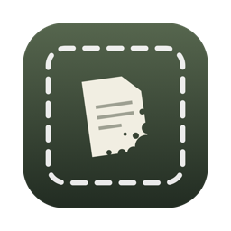
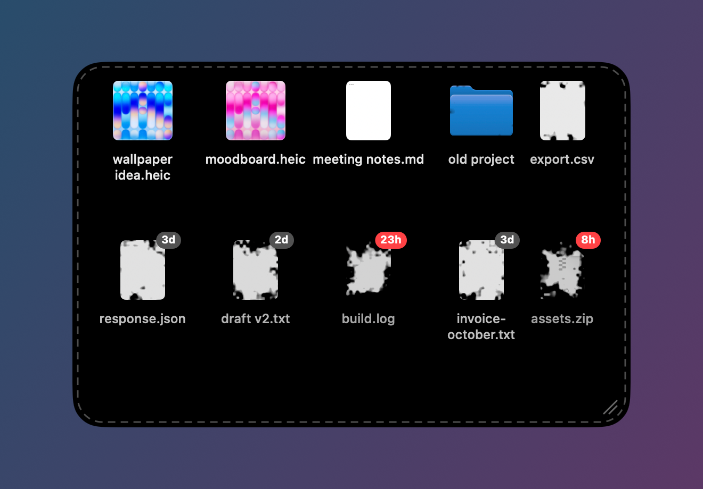

<h1> Landfill</h1>

A spot on the Mac desktop for files you need right now and will forget to delete.

Drop a file in and it sits there like any other desktop icon. If you don't touch it for 7 days it goes to the Trash. The icon decays a little each day, so you can see what is on its way out.

## What it does

- Files stay where you drop them. Open, Quick Look, rename and drag out all work the way they do on the desktop.
- Opening, previewing or saving a file gives it another 7 days.
- Expired files are moved to the Trash, not deleted. The clock keeps running while the Mac is asleep or off.
- The zone snaps to the desktop widget grid and takes on your widget style. Drag its edge, or Control-drag anywhere in it, to move it. Add Shift to place or size it freely. Rest the pointer on the resize corner to see the keys.
- When a page fills up, files continue on the next one. Swipe to turn pages.
- By default the zone is only an outline until the pointer is over it.
- Right click an empty part of the zone for Clean Up and Settings.

The files live in `~/Landfill`, which is a normal folder. Nothing is lost if the app is not running.

## Install

Needs macOS 13 or later. macOS 26 or later is recommended.

Download the zip from Releases, move `Landfill.app` to Applications and open it. The build is not notarized, so the first launch has to be allowed under System Settings > Privacy & Security > Open Anyway. macOS will also ask once for permission to move files out of Desktop, Documents or Downloads.

There is no Dock icon and no menu bar item. Open the app a second time, or right click the zone, to get to Settings.

## Settings

- Days before a file is trashed (1 to 30)
- Hide the zone until hovered
- Page direction, vertical or horizontal
- Open at login

## Known limits

macOS does not tell apps about every file read. A file counts as used when you open or preview it from the zone, open it from Finder, or save it. If another app only reads it through its own Open dialog, Landfill may not notice. The file still ends up in the Trash, where you can put it back.

## Building

Needs Xcode 26 or later.

    swift test
    Scripts/bundle.sh       # build/Landfill.app
    Scripts/release.sh      # dist/Landfill-<version>.zip, universal
    Scripts/budget.sh 500   # memory and idle CPU check with 500 files

`Sources/LandfillCore` is the expiry logic with no UI. `Sources/Landfill` is the app. There is no database: each file keeps its drop time and position in extended attributes named `com.landfill.*`.

At idle the app uses around 30 to 50 MB of memory and no CPU.

## Uninstall

Quit from Settings, delete the app, and take what you still need out of `~/Landfill`. Preferences can be removed with `defaults delete com.landfill.Landfill`.

## License

Copyright (c) 2026 melk. Released under the GNU General Public License v3.0, see [LICENSE](LICENSE). You may use, change and share the code, but anything you publish from it has to stay open under the same license.
